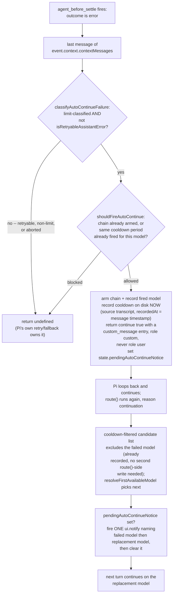
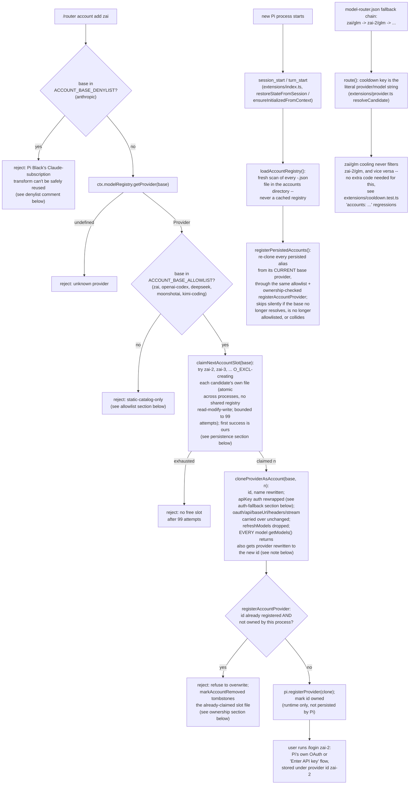

# Architecture: Pi Model Router Extension

The `pi-model-router` is an extension-first model router for the `pi` coding agent. It registers a custom logical provider (`router`) that exposes "profiles" as models (e.g., `router/balanced`). For every turn, the router intelligently selects an underlying concrete model based on task complexity, conversation phase, and user-defined rules.

## Core Concepts

### 1. Profiles & Tiers

The router is organized into **Profiles** (e.g., `balanced`, `cheap`, `deep`). Each profile defines up to three **Tiers** (at least one required):

- **High**: Reserved for architecture, design, complex debugging, and planning. Uses high-reasoning models.
- **Medium**: The default for standard implementation, multi-file edits, and focused fixes.
- **Low**: Used for summaries, changelogs, formatting, and simple read-only lookups.

### 2. Virtual Model Implementation

The extension uses `pi.registerVirtualModel` (and `pi.unregisterVirtualModel`) to register each configured profile under the `router` provider (`router/<profile>`). Pi cleanly separates **Selection** (`model_change` entries keep `router/<profile>`) from **Dispatch** (each assistant message records the physical `provider`, `model`, and `thinkingLevel`). This provides:

- Native footer display (`profile • level → physical-model • level`) and per-physical-model cost breakdown in `/session`.
- Safe conversation replay across different physical models and providers.
- Native pre-request auto-compaction when routing to a physical model whose context window is smaller than the current transcript.

## Routing Decision Flow

For every request sent to a `router/*` virtual model, `route(request, ctx)` inspects `request.reason`:

- **`direct` requests** (e.g., compaction summaries): Routed directly to the `medium` (or pinned) tier without mutating session routing state or running the classifier.
- **`continuation` requests** (tool-result continuations within a turn): Preserves the previous routed model for the turn to maintain provider prompt caches and thinking signatures (unless a new pin, budget cap, or image attachment requires switching).
- **`retry` requests** (automatic retry after a failed request): Advances to the next available model in the tier's `fallbacks` chain after `request.failed.model`.
- **`user` requests** (new user prompt, steer, or follow-up): Executes the full tier selection pipeline:
  1. **Budget Check**: If `maxSessionBudget` is configured and session spend exceeds it, downgrades `high` tier requests to `medium`.
  2. **Manual Pin**: Uses the tier pinned via `/router pin` or `/router fix`.
  3. **Custom Rules**: Matches keyword-based rules defined in config against the user prompt.
  4. **Classifier (Optional)**: When `classifierModel` is configured, prefers Pi's native classifier models (`ctx.modelRegistry.classify()` with `"auto"`, TypeSafe Jev, Cloudflare Clef / Clef Omni, OpenAI GPT-6 Luna, or `llama.cpp` classifiers — with image filtering and text-only fallback) and falls back to chat LLM classification (`ctx.modelRegistry.streamSimple()`).
  5. **Heuristics (Fallback)**: Uses fast local heuristics (keyword/length/tool-use analysis) if the classifier is off or fails.
  6. **Biased Stickiness**: The `phaseBias` setting modulates heuristic thresholds and low-confidence classifier probabilities to keep the router in a consistent phase.
  7. **First-Turn Auto-Pin (Optional)**: When `autoPinFirstTurnDecision` is enabled, the router automatically pins the active profile to the tier selected on the first turn of a conversation. Users can run `/router pin auto` at any time to unpin and return to dynamic per-turn routing.

## Cooldowns

The operator goal this subsystem serves: a Pi session must never become unresponsive because of a provider rate limit, and the router itself must never be the cause. Every cooldown code path is advisory and best-effort: any exception or bad input logs once and falls back to routing as if no cooldown existed. There are no locks, no leases, and no waits anywhere in `extensions/cooldown.ts` — nothing in this subsystem can spin or block a turn.

### Per-process files, no contention

Each Pi process writes only its own cooldown file, `~/.local/state/pi-model-router/cooldowns/<pid>-<startTimeMs>.json` (override the directory with `PI_MODEL_ROUTER_COOLDOWNS`; dir `0700`, file `0600`, atomic temp-file-then-rename, write failures logged once and otherwise ignored). There is nothing to lock: a process only ever appends to or deletes from its own file in memory, then best-effort persists it.

The temp file's name is `<ownFile>.<pid>.<8 random hex bytes>.tmp`, never a predictable name derived from the clock: it's opened with `openSync(tmp, O_WRONLY | O_CREAT | O_EXCL | O_NOFOLLOW | O_NONBLOCK, 0o600)`, written via the returned fd, and the fd is always closed in a `finally` before `renameSync`. `O_EXCL` means the open fails instead of silently writing through or hanging on any pre-existing path at that name — a FIFO, symlink, or attacker-planted file is refused, never opened; a predictable, clock-derived name previously let a FIFO pre-created at the exact path the process was about to write block `persistOwn()` (and therefore `record()`) forever. On any failure the temp path is unlinked best-effort — but only if this call actually created it (tracked separately from merely computing the path), so a failed `O_EXCL` open on someone else's pre-existing file never deletes that file.

Every read (`load()`, `candidates()`, `formatStatus()`) merges its own in-memory state with every other process's on-disk file in the directory, taking `max(until)` per `provider/model`, skipping unreadable or malformed files, and ignoring (then best-effort deleting) files whose mtime is older than 24h. Other processes' files and the factory state (below) are read at most once per `route()` call and cached for 2 seconds, keyed off the caller-supplied `now` rather than a separate wall clock, so repeated calls within one turn don't re-hit disk.

Because the cooldown directory (and the factory state path) can contain anything another process, a misconfigured mount, or an attacker leaves there, every file's _content_ is read via `openSync(path, O_RDONLY | O_NONBLOCK | O_NOFOLLOW)` followed by `fstatSync` on the open fd, keeping only entries where `stat.isFile()` is true and `stat.size <= 64 KiB`; the fd is always closed in a `finally`. `O_NONBLOCK` makes both the `open()` and the subsequent read on that fd return immediately instead of blocking forever, so a FIFO, socket, or device file dropped into the directory (e.g. `foreign.json` as a named pipe with no writer) is skipped, never hangs the read. `O_NOFOLLOW` rejects symlinks via the open call itself rather than trusting a separate `lstat`. Anything that isn't eligible is treated exactly like an unreadable or malformed file: skipped, never thrown.

Foreign files and the factory file are read **unmerged** into a flat list of `{ ref, entry }` pairs (one entry per file per model), not collapsed to a single `max(until)` winner per model, before the per-process merge and suppression pass below — this is what lets `clear()` track every source's entry for a model independently (see "Success and `/router cooldown clear`").

### Entry shape: category and bounded reset text only

A `CooldownEntry` is `{ until, reason, raw_reset_text, assumed_tz, source, recorded_at }`. `reason` is one of a fixed category set from `categorizeReason()`: `rate_limit | quota | usage_limit | too_many_requests | unknown` — never raw provider error text. `raw_reset_text` is limited to the substring the reset-time regex itself matched (e.g. `"retry in 10 min"`), truncated to 40 characters, never the surrounding message — so account identifiers or other message detail in a provider error can never land on disk. `source` is `retry | transcript | factory`.

### Recording: retry failures and new transcript errors only

`extensions/provider.ts` records a cooldown in two cases: (a) `request.reason === 'retry'` with a limit-classified `request.failed.message`, and (b) a transcript scan of `request.messages` for assistant messages with `stopReason: "error"` whose `timestamp` is newer than this process's start time (`state.processStartTime`, captured once at extension load) and not already in an in-memory `Set` of processed message timestamps (`state.processedTranscriptFailures`). Both are plain session state, never persisted — a historical failure from before this process started, or one already turned into a cooldown this run, is never reprocessed, including after `/router cooldown clear` or a restart.

`CooldownStore.record()` takes `now` and an optional `recordedAt` (defaulting to `now`) as separate parameters: `now` drives expiry math only — relative `"retry in N min"` parsing and the default cooldown length, both inherently about real wall-clock time — while `recordedAt` becomes the entry's `recorded_at`. Route-time (`'retry'`) failures have no earlier event time than the moment they're observed, so the provider passes only `now` and `recordedAt` defaults to it. Transcript-sourced failures pass the failed message's own `timestamp` as `recordedAt`, separate from the scan's `cooldownNow`: this is what lets `noteSuccess` below compare a success against when the failure actually happened rather than when the transcript scan that found it happened to run.

### Reset parsing, with a hard safety clamp

`parseResetTime()` prefers explicit offsets, then relative retry durations (`"retry in N s/m/h"`), then a naive local time in the provider's timezone (`RouterConfig.providerTimezones`, defaulting `zai`/`moonshot`/`kimi-coding`/`deepseek`/`qwen`/`alibaba`/`minimax` to `Asia/Shanghai` and everything else to UTC; the earlier interpretation wins on an ambiguous DST transition). Every computed date — regardless of which branch produced it — is validated before use: anything non-finite, unconstructible, already past, or more than 7 days out falls back to `now + 30 min` with `assumed_tz: "untrusted"`. This is what stops a malformed message like `"retry in 9999999999999999 hours"` from overflowing `Date`'s representable range and throwing out of `toISOString()`.

### Selection: usable candidates only, no leases

`extensions/provider.ts` passes `isUsableCandidate` (resolvable in the model registry _and_ authenticated) into `cooldownStore.candidates(modelsToTry, now, isUsableCandidate)`. Unusable refs always pass through untouched, and "keep the soonest-expiring candidate when everything is cooling" only ever picks among usable refs — filtering can never leave a tier with zero usable candidates. Once a cooldown's `until` has passed, every caller sees the model as available immediately; there is no probe lease or claim, so more than one process may retry a just-expired model at the same time — a new limit error simply re-records (one 429 per process per expiry is an accepted cost of removing the lease).

### Success and `/router cooldown clear`

When a model answers without error, `noteSuccess(modelRef, successTimestamp?)` removes it from the calling process's own file only — and only if that success is actually newer than the failure that armed it. `extensions/provider.ts` scans the whole transcript on every turn, so an old success message sitting earlier in the same transcript as a newer quota error must not erase the cooldown the newer error just recorded: `noteSuccess` compares `successTimestamp` against the model's own `recorded_at` and is a no-op unless the success is strictly newer, and the provider-side scan additionally ignores any success message timestamped at or before `state.processStartTime`, matching the rule already applied to transcript-sourced failures.

Because `recorded_at` for a transcript failure is the failure message's own timestamp (not scan time), this comparison is correct even when a single scan observes both a failure and a success for the same model in one pass: `[failure t1, success t2]` with `t1 < t2` clears the cooldown (the success is genuinely newer than the failure), while `[success t1, failure t2]` with `t1 < t2` leaves it cooling (the success predates the failure's own event time), regardless of how far in the past both timestamps are relative to the scan itself.

`clear(ref)` / `clear('all')` removes the entry from this process's own file and, for each cleared model, snapshots and suppresses the signature (`until`/`recorded_at`/`source`) of **every** foreign/factory entry for that model individually — not just whichever one currently wins the `max(until)` merge. This matters because a smaller foreign entry can be masked by a larger own (or other foreign) entry in the merged view; suppressing only the merged winner would let that smaller, genuinely unchanged foreign entry resurface the instant the larger entry is cleared or expires, making `clear()` look like a no-op. Each suppressed signature is independent: a ref is hidden from this process's merged view only while a foreign entry with that exact signature is still present, and lifts automatically (for that entry only) once the owning process writes a new one.

### Factory state: read-only, computed deterministically

`readFactoryEntries()` reads `/mnt/storage12tb/agent-factory/state/provider-switch.json` (path overridable for tests) but never writes to it. `until = probed_at (or since) + 30 min`, computed from the file's own observation timestamp — never from "now" — so re-reading an unchanged file always yields the same `until` and never renews a cooldown. A missing, malformed, or (`now - stamp > 24h`) stale file is ignored. Factory entries are computed live on every merged read rather than persisted to any process's file.

### `/router cooldowns` and `/router cooldown clear`

`/router cooldowns` and `/router status` show local and UTC reset times, source, raw reset text, and assumed timezone via `formatStatus()`. `/router cooldown clear <provider/model|all>` clears as described above.

See `extensions/cooldown.test.ts` for the regression coverage of the failure modes above: an unwritable directory, `ENOTDIR`, a directory sitting where the own file should be, stale/corrupt files, and a FIFO left in the cooldown directory or at the factory state path (`candidates()` must return within its timeout in every case, never throw, and never block); a FIFO pre-created at the old predictable temp-file name (`record()` must still return well within the subprocess timeout); a pre-existing file colliding with the new pid+random temp name (the write path must never open it, via `O_EXCL`, and must leave it byte-for-byte unchanged); and per-entry `clear()` suppression of a foreign entry masked by a larger own entry. See `extensions/provider.test.ts` (`cooldowns (integration)`) for the success-ordering regressions: an older success already in the transcript must never erase a cooldown recorded from a newer failure, a success genuinely newer than the recorded failure does clear it, and a single scan that observes both a failure and a success for the same model clears or keeps the cooldown based on which message's own timestamp is newer, not on scan order or scan time.

## Auto-Continue After a Non-Retryable Limit Error

When a turn routed by `router/*` ends with a non-retryable usage-limit error, the extension requests exactly one more model request on the next usable (non-cooling) model instead of surfacing the error, using Pi's own `agent_before_settle` boundary API -- never a synthetic `pi.sendUserMessage()` call. This is advisory like cooldowns: every path degrades to "do nothing" on any unexpected input or failure.

### Why `agent_before_settle`, not `turn_end`

The decision fires on `agent_before_settle`, not `turn_end`, because `turn_end`'s `continue` is silently discarded in exactly the case this mechanism exists for. In Pi's `agent-session.js`, `_installAgentBoundaryHooks()` wraps `finishTurn`:

```js
this.agent.finishTurn = async (turn, signal) => {
  const extensionContinue = await this._dispatchTurnEndBoundary(
    turn.message,
    turn.toolResults,
  ); // turn_end
  const previousDecision = await previousFinishTurn?.(turn, signal); // Pi's own retry/fallback decision
  if (previousDecision?.action === 'end') return previousDecision; // <-- extensionContinue is never consulted
  if (extensionContinue || previousDecision?.action === 'continue')
    return { action: 'continue' };
  return undefined;
};
```

`previousDecision?.action === "end"` is true for exactly the turns auto-continue targets: a non-retryable error Pi's own retry/fallback chain already gave up on. `turn_end`'s `{ continue: true }` is therefore live code that can never actually continue a turn in this scenario -- confirmed live (see "Live verification" below): with `turn_end` as the only hook, the session transcript showed the assistant error, then the `router-auto-continue` custom_message entry, and no further assistant message at all.

`agent_before_settle` is a separate boundary, dispatched by `_runBeforeSettleBoundary()` from the run loop itself, independent of `finishTurn`'s decision:

```js
async _runBeforeSettleBoundary() {
  const result = await this._extensionRunner.emitBoundary({ type: "agent_before_settle", outcome: this._lastActivityOutcome }, ...);
  this._commitBoundaryDrafts(result.entries);
  const finalContext = this._buildBoundaryContext([], "agent_before_settle");
  const shouldContinue = result.continue || this.agent.hasQueuedMessages();
  if (shouldContinue && !finalContext.canContinue) { ...; return false; }
  return shouldContinue;
}
```

Its `continue: true` is honored unconditionally (as long as the resulting context `canContinue`, i.e. the final message in the projected context is not itself an unanswered assistant message -- true once the handler's own `custom_message` entry, role `custom`, is appended). `event.context.contextMessages` is the full session projection at decision time, so the failed assistant message -- already persisted, not a draft -- is always its last element when the run just ended on that error.



`extensions/autocontinue.ts` holds the pure, independently testable decision logic:

- `classifyAutoContinueFailure()` (`extensions/autocontinue.ts:63`) accepts only an assistant message with `stopReason === "error"` (never `"aborted"`, so a user abort can never trigger this), whose `errorMessage` is both limit-classified by `cooldown.ts`'s `classifyLimitError()` (the exact categorizer cooldowns use) and **not** retryable per `isRetryableAssistantError()` imported from `@earendil-works/pi-ai` -- the identical predicate `agent-session.js`'s `_isRetryableError()` uses to decide whether Pi retries across fallback models before ending the turn. A retryable 429 is therefore left completely untouched: Pi's own retry/fallback chain already owns it. It also extracts the message's own `timestamp` (validated via `cooldown.ts`'s `isValidEventTimestamp()`), carried through for the cooldown `recordedAt` below.
- `shouldFireAutoContinue()` (`extensions/autocontinue.ts:115`) enforces two independent guards: `chainArmed` makes the mechanism one-shot per unbroken run of consecutive `agent_before_settle` errors ("never chain" -- if the continuation itself also fails, on any model, the run simply ends with that error); a model already auto-continued for while its cooldown is still active is skipped ("at most once per provider/model per cooldown period"), and gets a fresh budget once that cooldown expires or clears.
- `evaluateBeforeSettleForAutoContinue()` (`extensions/autocontinue.ts:175`) combines both, reading `event.outcome` and the last entry of `event.context.contextMessages` instead of a `turn_end`-style `event.message`, mutating an in-memory, non-persisted `{ chainArmed, firedModels }` guard (the same session-scoped, never-persisted lifetime as `processedTranscriptFailures` in `extensions/index.ts`) and returning the one `custom_message` entry draft plus `continue: true` and the failure's `errorMessage`/`timestamp` to fire, or `undefined` to stay silent.

`extensions/index.ts`'s `agent_before_settle` handler (`extensions/index.ts:456`) wraps the entire call to `evaluateBeforeSettleForAutoContinue()` in a try/catch that logs at most once and returns `undefined` on any exception -- matching the operator requirement that this path, like cooldowns, must never throw or block a run from settling. `turn_end` (`extensions/index.ts:440`) now only does cost accounting; it no longer makes any auto-continue decision.

On a decision to fire, the handler immediately calls `state.cooldownStore.record(decision.failedRef, decision.errorMessage, 'transcript', state.currentConfig, Date.now(), decision.timestamp)` (`extensions/index.ts:493`) before returning `continue: true`. This -- not `route()`'s existing transcript scan -- is what makes the cooldown visible to a **separate process** that resumes this session later: `route()`'s scan (`extensions/provider.ts`) only turns a message newer than _that process's own_ `state.processStartTime` into a cooldown, so a failure that happened entirely within the process that already exited would never be seen by a fresh `pi -p` invocation reading the same session file. Recording synchronously at the decision point, from the process that actually observed the failure, closes that gap. It then sets `state.pendingAutoContinueNotice` (`extensions/index.ts:505`) so `provider.ts`'s `route()` can name the actual replacement model once it is resolved; the `agent_before_settle` handler itself cannot know the replacement yet -- that choice happens later via the existing cooldown-filtered candidate list, which now also excludes the just-recorded model immediately.

The appended entry is a `custom_message` draft with `customType: "router-auto-continue"` (`extensions/autocontinue.ts:18`), not a literal user message: in the session file it is persisted as `role: "custom"`, and only Pi's own `convertToLlm()` turns it into a `role: "user"` provider-facing message -- the same mechanism compaction summaries and other extension-injected content already use, never `pi.sendUserMessage()`.

`extensions/provider.ts`'s `route()` fires the single notice (`extensions/provider.ts:759`): right after the replacement model is resolved, if `state.pendingAutoContinueNotice` is set it calls `actions.notify(ctx, "<failed> hit its usage limit; continuing on <next>", "info")` once and unconditionally clears the flag in the same step -- so a later, unrelated `route()` call can never re-fire it ("silent on later turns").

### Live verification

Unit tests over `evaluateBeforeSettleForAutoContinue()` alone cannot prove Pi actually honors the returned `continue: true`, since that depends entirely on Pi's own boundary-dispatch code outside this package. This was verified live: a fake OpenAI-compatible provider (`fake429`) returning HTTP 429 `insufficient_quota` on every request was configured as a profile's primary model with a working `deepseek` fallback, then run twice as separate `pi -p` processes sharing one `PI_MODEL_ROUTER_COOLDOWNS` directory and one resumed session:

```
run1 rc=0 hits=1   # fake429 hit once, auto-continue fired, deepseek answered "OK"
run2 rc=0 hits=1   # fake429 NOT hit again -- the cooldown recorded by run1 skipped it; deepseek answered "OK" directly
```

The session transcript for run1 showed, in order: `assistant` message from `fake429/limited` with `stopReason: "error"`, a `custom_message` entry with `customType: "router-auto-continue"`, then an `assistant` message from `deepseek/deepseek-v4-pro` with `stopReason: "stop"`. The cooldown file written by run1 recorded `fake429/limited` with `source: "transcript"` and `recorded_at` equal to the failed message's own timestamp, confirming both the continuation and the synchronous cooldown write.

See `extensions/autocontinue.test.ts` for the auto-continue decision regressions against `evaluateBeforeSettleForAutoContinue()` (fires once on a non-retryable limit error, reading only the last context message; never fires for a retryable 429, a non-limit error, or an abort; never chains across a second consecutive failure even on a different model; silent while the same model's cooldown is still active; fires again once that cooldown expires), `extensions/index.test.ts` (`agent_before_settle event: auto-continue`) for the `agent_before_settle` wiring -- including a disk-backed cooldown write assertion -- and `extensions/provider.test.ts` (`cooldowns (integration)` > `auto-continue notice`) for the single `ui.notify` firing with the resolved replacement model and never re-firing on a later `route()` call.

See `extensions/autocontinue.test.ts` for the auto-continue decision regressions (fires once on a non-retryable limit error; never fires for a retryable 429, a non-limit error, or an abort; never chains across a second consecutive failure even on a different model; silent while the same model's cooldown is still active; fires again once that cooldown expires), `extensions/index.test.ts` (`turn_end event: auto-continue`) for the `turn_end` wiring, and `extensions/provider.test.ts` (`cooldowns (integration)` > `auto-continue notice`) for the single `ui.notify` firing with the resolved replacement model and never re-firing on a later `route()` call.

## Accounts (multiple credentials per provider)

Pi stores one credential per provider id (`CredentialStore` in `@earendil-works/pi-ai`'s `dist/auth/types.d.ts`, keyed by `Provider.id`). `/router account add <provider>` (`extensions/commands.ts`, `handleAccount`) gives a second, third, ... credential slot for a provider by registering `<provider>-<n>` as a clone of the already-registered native `Provider` object under a new id, so `/login <provider>-<n>` writes to its own `auth.json` entry without touching the base provider's. The idea of registering one extra provider per account is adapted from [hjanuschka/pi-multi-pass](https://github.com/hjanuschka/pi-multi-pass) (MIT license; its `extensions/multi-sub.ts` ~L250-363 registers one extra provider per account via `pi.registerProvider` with hand-written provider templates); this router clones whatever native `Provider` object Pi already registered for the base id instead of re-declaring provider templates, which extends the same mechanism to `zai` and `deepseek` as well as `openai-codex`.



### Why every model's `provider` field must be rewritten, not just the `Provider.id`

`cloneProviderAsAccount` (`extensions/accounts.ts`) does not just change the top-level `id`/`name` and leave `getModels()` inherited unchanged. Every catalog entry a `Provider` returns carries its own `provider` field (`BaseModel` in `@earendil-works/pi-ai`'s `dist/types.d.ts`), separate from the containing `Provider.id`. Pi's dispatcher resolves which `Provider` to stream through, which credential to resolve, and which `provider/model` ref to report on failure from a model's _own_ `provider` field -- not from whichever `Provider.id` happened to return the model object.

This was a live defect, not a hypothetical one: an earlier version of this clone left `getModels()` as the inherited reference, so every model the clone returned still said `provider: "fake429"` (the base id). Requests "routed" to `fake429-2/limited` dispatched through the base provider's own registration, the clone's separate credential slot was never actually used, and failures were reported -- and cooled down -- under `fake429/limited` again instead of `fake429-2/limited`, silently defeating both account separation and independent cooldowns. `rewriteModelProvider` (`extensions/accounts.ts`, just above `cloneProviderAsAccount`) fixes this: every model `getModels()`/`getAllModels()` return gets a fresh copy with `provider` rewritten to the alias id. `extensions/accounts.test.ts`'s `cloneProviderAsAccount` suite regression-tests this directly.

### An account never authenticates through the base's env var or configured key

Pi's credential store is keyed by `Provider.id`, so an alias with no `/login <alias>` entry yet has `credential === undefined` whenever Pi resolves its auth. Both `@earendil-works/pi-ai`'s `envApiKeyAuth` (`dist/auth/helpers.js`, used by `zai`/`deepseek`/`moonshotai`/`kimi-coding`'s `apiKey` auth) and pi-coding-agent's `composeApiKeyAuth` (`dist/core/provider-composer.js`, used for every `models.json`-declared provider) treat `credential === undefined` as "fall back to the ambient env var / configured key", not "unauthenticated" -- by design, for a provider that has never been given its own credential at all. Without a fix, a freshly added account alias has exactly that shape (`credential === undefined`), so it silently inherited the base's auth: live-verified 2026-11 against a local fake 429 provider declared in `models.json` with a baked-in `apiKey`, an alias registered without this fix authenticated through the base's configured key and was dispatched as if logged in.

`wrapApiKeyAuthForAlias` (`extensions/accounts.ts`, used by `cloneProviderAsAccount`) fixes this: the clone's `apiKey.resolve` (and `check`, when the base defines one) returns `undefined` immediately whenever `credential` is absent, and only delegates to the base's original `resolve`/`check` once a credential IS stored for the alias's own id. This is the supported extension point -- `ApiKeyAuth.resolve`/`check` in `@earendil-works/pi-ai`'s `dist/auth/types.d.ts` -- there is no separate flag to disable just the ambient-fallback half of resolution; `login` (which writes to the alias's own `auth.json` entry) and `oauth` auth are left untouched. The practical effect: `/router account list` shows an unconfigured alias as "not logged in" (`handleAccount`'s `accountAuthLabel`, backed by `ctx.modelRegistry.hasConfiguredAuth`), and `extensions/provider.ts`'s `resolveRoutedCandidate` -- which already skips any candidate `hasConfiguredAuth` reports as unconfigured -- now correctly skips an unconfigured alias even when its base has a working key. `extensions/accounts.test.ts`'s `cloneProviderAsAccount` suite regression-tests both the `envApiKeyAuth`-style and `composeApiKeyAuth`-style ambient-fallback paths.

### Only a static-catalog provider can be cloned

`ACCOUNT_BASE_ALLOWLIST` (`extensions/accounts.ts`) permits only `zai`, `openai-codex`, `deepseek`, `moonshotai`, and `kimi-coding`. `cloneProviderAsAccount` shares every field it does not explicitly override by reference between the base and every clone; a provider with a credential-dependent `refreshModels` hook (`Provider.refreshModels` in `@earendil-works/pi-ai`'s `dist/models.d.ts`) would have that hook -- and whatever catalog state it closes over -- shared across the base and every account, so refreshing one account's catalog could silently overwrite what another account (or the base) sees. Verified 2026-11 against the installed `@earendil-works/pi-ai` build (`node_modules/@earendil-works/pi-ai/dist/providers/{zai,openai-codex,deepseek,moonshotai,kimi-coding}.js`): none of these five pass `fetchModels` to `createProvider`, so none define `refreshModels` -- all five return a fixed, bundled model list. `/router account add <other>` is refused with an explicit message naming the allowlist; `cloneProviderAsAccount` also drops `refreshModels` outright on every clone as a second, defense-in-depth guard, and `registerPersistedAccounts` re-checks the allowlist on every re-registration (covers a hand-edited registry file or a narrower allowlist shipped later).

### Collisions: an alias id is only overwritten by the feature that owns it

`registerAccountProvider`/`unregisterAccountProvider` (`extensions/accounts.ts`) track which provider ids this process has itself registered, in an in-memory `Set<string>` (`ownedAccountProviderIds`, never persisted -- `pi.registerProvider()` is a runtime-only call, so every process starts with an empty set and earns ownership by registering). Before registering an alias -- from `/router account add` or from `registerPersistedAccounts` on every `session_start`/`turn_start` -- `registerAccountProvider` checks whether a provider already exists at that id; if it does and this process has not itself claimed it, registration is refused rather than silently overwriting whatever that id already pointed at (another extension, a `models.json` entry, or a genuine id clash). `/router account remove` mirrors this: `unregisterAccountProvider` only calls `pi.unregisterProvider` for an id this process owns, so it can never unregister a provider this feature never actually registered.

### Account numbers are never reused, and a slot is claimed atomically across processes (P1 fix)

An earlier version kept one shared `model-router-accounts.json`, read by every process, mutated in memory, and written back whole. Two processes racing `/router account add zai` at the same moment both read the same "next number is 2", both registered a clone under `zai-2` for two _different_ real accounts, and whichever process's write landed last silently overwrote the other's just-added entry on disk -- identity reuse and a lost account in the same race. Removal had the same shape in the other direction: `/router account remove` read-modified-wrote the whole file too, so a remove running concurrently with another session's add (or a stale in-memory snapshot from before that add) could write back a version of the file that simply never had the other session's new account in it, erasing it.

There is no shared registry file anymore. Each account is its own file, `<accountsDir>/<base>-<n>.json` (`defaultAccountsDir()`: `~/.local/state/pi-model-router/accounts/`, override with `PI_MODEL_ROUTER_ACCOUNTS` -- same env-override pattern as `cooldown.ts`'s `PI_MODEL_ROUTER_COOLDOWNS`), and that file's mere existence -- active or removed -- is the only fact that matters for whether `<n>` is taken. `claimNextAccountSlot` (`extensions/accounts.ts`) tries `<base>-2`, `<base>-3`, ... up to 99 times, `O_EXCL`-creating each candidate's file (`openSync` with `O_WRONLY|O_CREAT|O_EXCL|O_NOFOLLOW|O_NONBLOCK`, mode `0o600`); `O_EXCL` create-if-absent is atomic at the filesystem level, so when two processes race on the same base, the kernel hands the same path to only one of them -- the loser's `createAccountFileExclusive` call fails and it moves on to the next candidate number, landing on a _different_ id with no read-then-write window for two processes to land on the same one. `markAccountRemoved` (`/router account remove`) never deletes a file -- it's a tombstone, rewritten in place via the same temp-file-then-rename pattern as `cooldown.ts`'s `persistOwn()`, and only ever touches that one alias's own file, so one session's remove can never erase a different session's accounts, for the same or a different base. Because the file keeps existing once created, no later `claimNextAccountSlot` call from any process can ever reclaim a removed number: `zai-3` removed means `zai-3.json` still exists (now `{ removed: true, ... }`), so the next add goes straight to `zai-4`.

As required (a lock-based design previously hung Pi -- see the "Per-process files, no contention" cooldowns section above): there are no locks, leases, or waits anywhere in this file. A losing `O_EXCL` attempt is not retried against the same number; the next candidate is tried immediately, bounded at 99 attempts total.

`extensions/accounts.test.ts` regression-tests this directly: two independent callers sharing one directory (A add -> A remove -> B add) always lands B on the next unused number, never A's just-removed one; removing one account never erases a sibling account for the same or a different base; and -- because in-process interleaving can't prove cross-process atomicity -- two real `node --experimental-strip-types` child processes racing `claimNextAccountSlot` for the same base (same technique as `cooldown.test.ts`'s FIFO regressions) always land on two distinct numbers.

There is no longer a cached in-memory registry to go stale across a session either: `/router account list`, `/router account remove`'s existence check, and its own autocomplete all call `loadAccountRegistry()`/`readAccountEntry()` fresh on every invocation (a plain directory scan, no caching) rather than consulting a snapshot taken at session start -- a two-process race on _reading_ state can corrupt nothing further here, since each process's view is always current as of that exact call.

Also fixed: `claimNextAccountSlot` always persists the claim to disk _before_ `registerAccountProvider` is ever called (`handleAccount`'s `add`), so there is never a window where a provider is registered at runtime with nothing on disk claiming its slot. If registration then fails, the already-claimed file is tombstoned via `markAccountRemoved` -- never deleted -- so that number is still never reused even though no account was ever actually usable at it.

`AccountFileRecord` fields are `base`, `accountNumber`, `removed`, `createdAt`, and `removedAt` (once removed) -- base provider ids, small integers, and timestamps, exactly as credential-free as the old single-file registry.

See `extensions/accounts.ts`'s module doc comment for the full design rationale.

### `anthropic` is refused

`ACCOUNT_BASE_DENYLIST` (`extensions/accounts.ts`) rejects `anthropic`. Pi Black (`git:github.com/paoloanzn/pi-black`, not modified by this feature) rewrites only the built-in `anthropic` provider's requests to satisfy Claude subscription billing (`wrapAnthropicProvider` in its `src/anthropic-provider.ts`, invoked from its `extensions/pi-black.ts`). That module ships with `"private": true` and no `exports`/`main` field in pi-black's `package.json` -- it is not a published dependency, so importing it here would mean depending on another extension's internal, unversioned file layout instead of a documented integration boundary (`registerProvider`'s `Provider`/`ProviderConfig` surface). A second Anthropic account registered without that transform is rejected upstream the first time it streams with `"Third-party apps now draw from your extra usage"`, so `/router account add anthropic` is rejected here instead, before any request is made (`extensions/commands.ts`, `handleAccount`).

### Persistence: never a credential, re-applied every process start, atomic command handlers

`pi.registerProvider()` is a runtime call Pi does not persist itself, so every new process must redo it: `extensions/index.ts`'s `restoreStateFromSession` (`session_start`/`session_tree`) and `ensureInitializedFromContext` (the `turn_start`/`model_select`/`turn_end` fallback for contexts where `session_start` never fires, same rationale as the router's own virtual-model re-registration) both re-read the registry fresh with `loadAccountRegistry()` and call `registerPersistedAccounts()` (`extensions/accounts.ts`), which re-clones each persisted alias from whatever its base provider currently resolves to and skips a base that no longer resolves, is no longer allowlisted, or collides, rather than throwing.

`handleAccount`'s `add` (`extensions/commands.ts`) claims the slot's file first (always persisted on success, before any runtime registration), then registers the provider; if registration then fails, the already-claimed file is tombstoned (`markAccountRemoved`) rather than deleted, and the failure is reported. `remove` unregisters the runtime provider (only if this process owns that id) and then tombstones the file; if the tombstone rewrite itself fails, the handler re-registers the clone so the runtime state matches what the (unchanged) on-disk file still says -- active -- and reports the failure to the user rather than leaving the runtime registration and the on-disk file disagreeing about what exists. See "Account numbers are never reused, and a slot is claimed atomically across processes (P1 fix)" above for the full per-file persistence design.

### Routing and cooldowns need no new code

A fallback chain simply names `<base>-<n>/<model>` like any other `provider/model` ref (`model-router.json`'s `fallbacks`). Cooldowns are already keyed by the literal `provider/model` string built from whichever provider id actually routed the request (`extensions/provider.ts`), so `zai/glm-5.3` cooling down never filters `zai-2/glm-5.3` out of candidates, and vice versa -- see `extensions/cooldown.test.ts`'s "accounts: an alias provider id ... cools down independently of its base" regressions. `extensions/accounts.test.ts` covers alias naming/parsing, atomic per-file account-slot claiming and non-reuse (including the two cross-process races described above), a corrupt/malformed/misnamed account file degrading to "skip it" rather than throwing, a check that no account file ever contains anything key/token/secret/credential-shaped, the ambient-auth-fallback block, the allowlist, ownership-checked registration/unregistration, and `registerPersistedAccounts` re-registration (including a base that no longer resolves, a base no longer allowlisted, a collision with an unowned id, and one bad clone never blocking the others). `extensions/commands.test.ts`'s `handleAccount` suite covers `add`/`list`/`remove` against a real temporary accounts directory, the `anthropic` rejection message, the allowlist rejection message, an unknown base provider, ownership-gated remove, rollback when the account-slot claim fails, rollback when provider registration fails after a successful claim (the "add" persistence-failure case), rollback when the tombstone rewrite fails on remove, a fresh re-scan on every `list` call picking up another session's on-disk account, one session's remove never erasing a different base's on-disk account, and autocompletion.

### Live verification

Verified live against a local fake 429 provider (`fake429`, `http://127.0.0.1:8799/v1`, declared in `models.json` with a baked-in `apiKey` -- the configured-key ambient-fallback scenario above) with `model-router.json`'s `orchestrator` profile high tier set to `fake429/limited` with fallbacks `[fake429-2/limited, deepseek/deepseek-v4-pro]`: an alias registered via `/router account add fake429` with no `/login fake429-2` credential of its own was skipped as unusable even though the base's configured key still worked (only the base was hit); after storing a dummy credential for `fake429-2` in `auth.json` through Pi's supported credential-store API, the alias was used and cooled down independently of the base. Two separate `pi --no-session --model router/orchestrator --print ...` processes shared one `PI_MODEL_ROUTER_COOLDOWNS` directory:

```
run1: fake429/limited -> 429, fake429-2/limited -> 429 (both independently cooled), deepseek -> "OK"
      hits.log: 2 (one per account; fake429 and fake429-2 share one backend port)
      cooldown entries recorded: fake429/limited, fake429-2/limited (two distinct keys)
run2: fresh process, same cooldown dir -- both accounts already cooling, so neither is
      tried at all; goes straight to deepseek -> "OK"
      hits.log: unchanged at 2 (zero new hits in run2, confirming both limited accounts were skipped)
```

## Module Architecture

The extension is modularized for maintainability:

- `extensions/index.ts`: Orchestrator. Manages state, hooks into `pi` events, and wires modules together.
- `extensions/provider.ts`: Implements the `router` provider, cooldown detection, and delegation/retry loop.
- `extensions/cooldown.ts`: Shared cooldown persistence, reset parsing, factory-state ingestion, and candidate filtering.
- `extensions/autocontinue.ts`: Decision logic for the one-shot auto-continue after a non-retryable limit error (see "Auto-Continue After a Non-Retryable Limit Error" above).
- `extensions/accounts.ts`: Extra provider "account" registry persistence and native-`Provider` cloning (see "Accounts (multiple credentials per provider)" above).
- `extensions/routing.ts`: Core decision logic, heuristics, and the LLM classifier.
- `extensions/config.ts`: Loads, merges, and normalizes the JSON configuration.
- `extensions/commands.ts`: Registers all `/router` subcommands and their autocompletions.
- `extensions/ui.ts`: Manages the status line and the optional state widget.
- `extensions/state.ts`: Handles session-persisted state and snapshots.
- `extensions/types.ts`: Centralized interface and type definitions.

## Thinking Resolution

For the model actually selected, thinking resolves in `extensions/provider.ts:276-304` (`resolveDelegatedThinking`): an explicit `/router thinking` override wins first, then the selected fallback's optional `thinking`, then the tier's `thinking` (the primary model always uses the tier value). The result is clamped against the selected model's capabilities with `clampThinkingLevel` in `extensions/config.ts:752-774` before dispatch and status/debug reporting.

## State & Persistence

The router state is persisted using `pi.appendEntry` with a custom type `router-state`. This allows the router to:

- Restore the active profile and pins across agent relaunches.
- Maintain independent pins and state for different conversation branches.
- Track accumulated session costs safely.

## Reliability: Fallback Chains

Each tier in a profile can define an optional `fallbacks` list. If the primary model fails (e.g., due to rate limits or provider downtime), the router automatically retries the next model in the chain before surfacing an error to the user.
